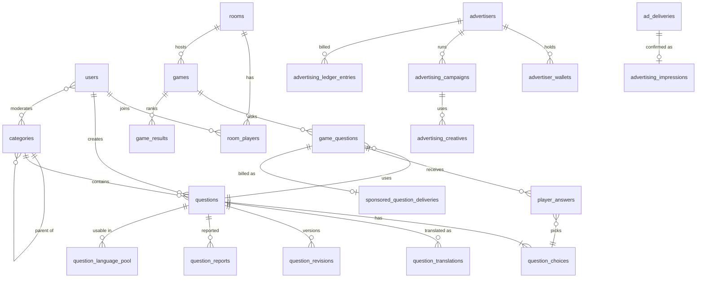

# Fakkroun (فكّرون) — Technical Assessment & Roadmap

> **Deliverable:** §2.4 of the master specification, the assessment required before any implementation.
> **Base:** `Mohammadtrabelsi/MajidaStarter` @ `develop` (`7260135`), imported into this repository with full history (151 commits). No new Laravel application was created.
> **Date:** 2026-11-03
> **Status:** Approved 2026-11-04 with all recommendations in §10. Phase 1 is reported in [`01-phase-1-report.md`](01-phase-1-report.md).

---

## 1. Repository architecture assessment

| Aspect | Finding |
| --- | --- |
| Framework | **Laravel 13.38** (`laravel/framework ^13.8`), streamlined `bootstrap/app.php` structure (no Kernel classes) |
| PHP | `composer.json` says `^8.3`, but `composer.lock` resolves Symfony 8 / 17 packages that need **PHP ≥ 8.4.1**. CI already runs 8.4 only. See risk R1. |
| Frontend | **Livewire 4.4** single-file page components (`resources/views/pages/**/⚡*.blade.php`, routed with `Route::livewire(..., 'pages::...')`), Alpine (bundled with Livewire), **Tailwind CSS 4** via `@tailwindcss/vite`, **Vite 8**. No SPA framework and no JS framework dependencies. |
| Architecture | Thin Livewire components and API controllers that delegate to a **service layer** (`app/Services/*Service.php`), which holds the business rules. `DomainActionException` reports rule violations. Policies exist for `Post` and `Category`. |
| Auth | Session auth with registration, login (per email+IP rate limiting), logout, email verification (queued), password reset (queued), **TOTP two-factor** with recovery codes, Sanctum personal access tokens, honeypot on register/forgot-password |
| Authorization | `spatie/laravel-permission` v8. A single seeded role (`admin`) holds 9 permissions. Routes use `can:<permission>`. The whole `/admin` group is also behind the `admin` middleware (`EnsureUserIsAdmin` → `hasRole('admin')`). |
| i18n | **`en`, `ar` (RTL), `fr` already supported** through `config('app.available_locales')`, with `dir` per locale, `SetLocale` middleware (session-based), a locale switcher, `spatie/laravel-translatable` JSON columns for content, and a `translations:sync` command (`mohammadtrabelsi/laravel-translation-sync`). Every UI string has a translation file in all three languages. |
| Data | 24 migrations covering users (soft deletes, 2FA, user stamps), Spatie permission tables, activity log, settings singleton, categories, posts, tags, notifications, visits, sessions/cache/jobs tables, Sanctum tokens |
| Queues / scheduler | `QUEUE_CONNECTION=database` by default. Jobs: `GenerateSitemapJob`, `RunBackupJob`. Scheduler runs activity-log pruning, sitemap, health heartbeats and backups. |
| Broadcasting | **None configured.** `BROADCAST_CONNECTION=log`, and there is no `config/broadcasting.php`, `routes/channels.php`, Reverb or Echo. |
| Ops | Docker (`php`, `nginx`, compose), spatie/laravel-health (DB, cache, queue, schedule, disk checks, `/health.json` token endpoint), spatie/laravel-backup, `/up` liveness |
| Quality | 52 feature test files (~368 tests), PHPUnit 12, Pint, Larastan (`phpstan.neon.dist`), GitHub Actions CI (tests + build + Pint + PHPStan) |
| Conventions | Model `casts()` methods, `#[Fillable]`/`#[Hidden]` attributes, `TracksUserActions` (`created_by`/`updated_by`), `LogsActivity` on every domain model, soft deletes on content, `HasUniqueSlug` / spatie sluggable, services return models, list screens use `searchPaginated()` + `stats()` with single aggregate queries |
| Scaffolding | `php artisan starter:make-crud {Name}` generates model, migration, factory, service, policy and test, following house conventions. Fakkroun modules should use it where it fits. |

**Overall:** solid foundation with a disciplined service layer. The parts Fakkroun needs most (auth, RBAC, AR/FR/EN with RTL, translatable content, CSV/XLSX import, audit, notifications, health) **already exist and are tested**. The gaps are entirely in the domain: questions, games, real-time and advertising.

## 2. Existing functionality inventory → Fakkroun mapping

| Existing feature | Fakkroun use | Action |
| --- | --- | --- |
| Registration / login / verification / reset / 2FA / honeypot | §4 authentication | **Reuse as is.** Add suspension and preference fields. |
| Sanctum tokens + `/api` mirror of services | Future mobile app, API docs | **Reuse.** Add Fakkroun endpoints the same way. |
| spatie/laravel-permission, `admin` role | §3 RBAC | **Extend.** Add `player`, `moderator`, `advertiser` roles plus new permissions. Add a per-category moderator scope (pivot). |
| `EnsureUserIsAdmin` on all `/admin` routes | Back office | **Change.** Moderators and advertisers need parts of the back office, so the gate becomes permission-based (`access backoffice`). |
| `available_locales` (en/ar/fr, RTL) + `SetLocale` | §5 interface language | **Extend.** Read `users.locale` before the session value. Add an independent `users.question_locale`. |
| spatie/laravel-translatable | Category / setting translations | **Reuse** for categories. **Not used for questions** (per-language approval needs a row per translation; see §5). |
| `Category` model + admin CRUD + CSV/XLSX import/export | §6 categories | **Extend** with `parent_id` (subcategories), `sort_order`, `icon`, `color` and validation-policy fields. See decision D1. |
| `Post` / blog / tags / RSS / sitemap / schema.org | Educational articles ("Learn" section) | **Keep** working. Rebrand later. Not on the critical path. |
| `Setting` singleton + `SettingService` | §12.4 / §17.2 configurable limits | **Extend** with a typed `game_settings` / `ad_settings` config (see §5.9). |
| `SpreadsheetService` (streamed export, lazy chunked import, per-row validation, formula-injection sanitising) | §11 question import/export | **Reuse.** Add JSON reader, column mapping, preview and async (queued) batches. |
| spatie/activitylog + `TracksUserActions` + activity-log UI/export | §25 audit_logs, §7.3 moderation history | **Reuse.** No separate `audit_logs` table needed. |
| Database notifications + `CrudNotificationObserver` + notifications page | §23 notifications | **Reuse** and add domain notifications. Add the `broadcast` channel once Reverb is in. |
| `TrackVisit` / `VisitService` | §24 analytics (traffic part) | **Reuse.** |
| spatie/laravel-health, backups, Docker | §31 operations | **Reuse.** Add Reverb and queue-worker processes, plus a Redis check. |
| Light/dark theme, toast hub, form components, `brand-mark` | §22 UI | **Reuse.** Restyle to the Fakkroun identity. |
| About page ("Magie d'Astrata"), `APP_NAME=MajidaStarter`, welcome/marketing copy, favicons | — | **Replace** with Fakkroun branding (Phase 1). |

## 3. Reusable components and modules

- **Service-layer pattern**: every new module gets a `*Service` that Livewire pages and API controllers both call.
- **`DomainActionException`** for rule violations (room full, game already started, insufficient credits, etc.).
- **`SpreadsheetService::import()`** pipeline: per-row validator, chunked transactions, `ImportResult` error report.
- **`starter:make-crud`** to scaffold Question, Room, Campaign, Package, and similar resources.
- **Activity log** for question revisions/moderation, ledger adjustments and setting changes.
- **Locale tabs** in the post/settings forms, the pattern for translation editing.
- **`InteractsWithToasts`**, `toast-hub`, `input-*` components, `layouts/app` + `layouts/guest` with RTL support.
- **`Health` checks** to extend with Reverb and Redis.

## 4. Missing functionality required by Fakkroun

1. Roles beyond `admin`, plus category-scoped moderation.
2. Per-user interface and question language, avatar, account suspension, account activity history (activity log filtered by causer).
3. Subcategories, category ordering and per-category validation policy.
4. **The whole question domain**: questions, choices, translations, lifecycle, revisions, reports, moderation log, duplicate detection, community submissions, usage statistics.
5. **The whole multiplayer domain**: rooms, codes, invitation URL, QR, lobby, games, server-authoritative timers, answers, duplicate-answer rule, scoring, leaderboards, reconnection.
6. **Real-time broadcasting** (no infrastructure today).
7. AI generation (provider abstraction, batches, logs, cost tracking).
8. JSON import, column mapping, preview and async import batches.
9. **The whole advertising domain**: advertisers, campaigns, creatives, packages, wallets, immutable ledger, impressions, sponsored-question deliveries, reconciliation, dashboard.
10. Player-facing pages (dashboard, room flow, gameplay, results, leaderboards, submissions) and Fakkroun branding.
11. Domain analytics (game, question and advertising aggregates).

## 5. Proposed database changes

All new tables use `foreignId()->constrained()`, explicit composite indexes for hot queries, and `unique` constraints wherever the database itself must guarantee an invariant (idempotency, one answer per player, one billing reference). Money is stored as **integer minor units + ISO currency code**. Language columns are `string(8)` codes validated against `config('app.available_locales')`, so adding a language is a configuration change, not a schema change.

### 5.1 Users & authorization (alter existing)

- `users`: `+ locale`, `+ question_locale`, `+ avatar_path`, `+ status` (`active|suspended`), `+ suspended_at`, `+ suspension_reason`, `+ last_seen_at`.
- `category_moderator` (`category_id`, `user_id`, unique pair): moderator scope.
- Roles and permissions are seeded into the existing Spatie tables. No new auth tables.
- `user_achievements`: Phase 6 (optional).

### 5.2 Categories (alter existing)

- `categories`: `+ parent_id` (self-FK, nullable → subcategory), `+ sort_order`, `+ icon`, `+ color`, `+ validation_policy` (`admin|moderator|community`), `+ requires_reference` (bool), `+ allow_community_submissions` (bool).
  Subcategories use a self-referencing `parent_id` instead of separate `subcategories` tables, at one level deep. Translations stay in the existing JSON columns.

### 5.3 Question bank

| Table | Key columns | Notes |
| --- | --- | --- |
| `questions` | `id`, `uuid`, `category_id`, `subcategory_id?`, `creator_id`, `origin_language`, `type` (`mcq` now), `difficulty` (`easy|medium|hard`), `correct_choice_id`, `source` (`admin|community|ai|import|partner`), `reference_url?`, `reference_text?`, `status` (`draft|pending|under_review|approved|rejected|published|unpublished`), `published_at`, `reviewed_by?`, `reviewed_at?`, `rejection_reason?`, `content_hash`, `is_sponsored`, `campaign_id?`, `version`, soft deletes | `content_hash` is indexed for exact duplicate detection. Index on (`status`, `category_id`, `difficulty`). |
| `question_choices` | `id`, `question_id`, `position` (1–4) | **Stable choice IDs.** `questions.correct_choice_id` points here, never at text. Unique (`question_id`, `position`). |
| `question_translations` | `id`, `question_id`, `language`, `body`, `choices` (JSON `{choice_id: text}`), `explanation?`, `status` (`pending|approved|rejected`), `translated_by`, `validated_by?`, `validated_at?`, `rejection_reason?`, `is_machine_translated` | Unique (`question_id`, `language`). **Per-language approval is independent** (§5.4 of the spec). Choice texts sit in the translation row so a translation is approved as one unit, and the service checks that the keys match `question_choices` exactly. |
| `question_revisions` | `question_id`, `version`, `snapshot` (JSON), `changed_by`, `reason` | Written on every content edit. Editing an approved question bumps `version` and sends it back to `pending` (re-validation). |
| `question_moderation_logs` | `question_id`, `translation_id?`, `actor_id`, `action`, `from_status`, `to_status`, `reason?` | Append-only lifecycle trail (the activity log also records it). |
| `question_reports` | `question_id`, `reporter_id`, `reason`, `details`, `status`, `resolved_by?` | Unique (`question_id`, `reporter_id`) while open. |
| `question_language_pool` | `question_id`, `language`, `category_id`, `subcategory_id?`, `difficulty`, `is_sponsored`, `random_key` (float), `last_served_at` | **Selection index** (see §8.2). Holds one row per *usable* (question, language). The service keeps it in sync on publish/unpublish/approval transitions. Index (`language`, `category_id`, `difficulty`, `random_key`). |
| `question_stats` | `question_id`, `language`, `times_served`, `times_correct`, `total_response_ms` | Counters updated in batches after each game. |
| `player_question_history` | `user_id`, `question_id`, `last_seen_at`, `times_seen` | Unique pair. Used for anti-repetition. Old rows can be pruned. |

### 5.4 Multiplayer

| Table | Key columns | Notes |
| --- | --- | --- |
| `rooms` | `id`, `ulid`, `code` (unique, 6–8 chars, no ambiguous characters), `host_id`, `name`, `visibility`, `status` (`waiting|ready|in_progress|completed|cancelled`), `settings` (JSON: categories, question count, difficulty mix, language policy, duration, duplicate rule, community/sponsored inclusion), `max_players`, `expires_at` | The status machine lives in `RoomService` and is guarded by `lockForUpdate()`. |
| `room_players` | `room_id`, `user_id`, `joined_at`, `left_at?`, `last_seen_at`, `connection_state`, `question_language` | Unique (`room_id`, `user_id`). |
| `games` | `room_id`, `status`, `started_at`, `ended_at`, `settings_snapshot` | Settings are frozen at start so later admin changes don't affect a running game. |
| `game_questions` | `game_id`, `question_id`, `position`, `round`, `question_version`, `opened_at`, `deadline_at`, `closed_at?`, `is_sponsored`, `campaign_id?` | **Server timer:** `deadline_at` is authoritative. Unique (`game_id`, `position`). `question_version` plus the revision snapshot keep history intact even if the question is later edited or deleted. |
| `player_answers` | `game_question_id`, `user_id`, `choice_id?`, `received_at`, `response_ms`, `is_correct`, `is_duplicate_excluded`, `points` | **Unique (`game_question_id`, `user_id`)**: the database rejects a second submission. |
| `game_results` | `game_id`, `user_id`, `score`, `rank`, `correct`, `incorrect`, `excluded`, `total_response_ms` | Final standings. Per-question points live in `player_answers`, so a separate `player_scores` table is not needed. |
| `game_events` | `game_id`, `type`, `payload`, `created_at` | Append-only event log used for audit, reconnection replay and load-test analysis. |

Rounds are a `round` column on `game_questions` rather than a separate `game_rounds` table, until sponsored rounds need their own attributes (Phase 5).

### 5.5 AI & imports

- `ai_generation_batches`: requester, provider, model, prompt_version, parameters (JSON), requested/generated/accepted/rejected counts, status, token usage, estimated cost, and errors.
- `ai_generation_items`: batch_id, raw output, validation result, question_id (if accepted), and duplicate-of reference.
- `import_batches` / `import_errors`: file, format, column mapping, preview, status, counts, and row-level errors.

### 5.6 Advertising & billing

| Table | Notes |
| --- | --- |
| `advertisers` | Organisation profile. `user_id` owner, type (NGO, school, company…), status. |
| `advertising_packages` | Name (translatable), `impression_credits`, `sponsored_question_credits`, `price_minor`, `currency`, `is_active`, `is_custom`. **Prices are data, never code.** |
| `advertiser_wallets` | (`advertiser_id`, `credit_type` ∈ {`impression`, `sponsored_question`}) **unique**, `balance` (unsigned, with a `CHECK balance >= 0` where the driver supports it). Separate rows per credit type mean the two balances **cannot be mixed**. |
| `advertising_ledger_entries` | **Append-only** (no update/delete paths, and the model throws on `updating`/`deleting`): advertiser, campaign, wallet/credit type, format, `entry_type` (`purchase|consumption|refund|adjustment|reversal`), signed `quantity`, `unit_price_minor`, `amount_minor`, currency, room/game_question/player refs, **`billing_reference` unique**, status, `created_by`, `created_at`. Corrections are new reversal entries, never edits. |
| `advertising_campaigns` | Advertiser, name, status (`draft|pending_review|active|paused|exhausted|completed|rejected`), start/end, target categories and languages, frequency caps, `budget_minor` (separate from credits), and review fields. |
| `advertising_creatives` | Campaign, format (`banner|logo|in_game|post_game|sponsored_round|sponsored_category`), language, asset path, alt text, link (optional, opens in a new tab), review status. |
| `ad_deliveries` | Server-issued delivery record per (player, game_question, creative): `delivery_token`, `issued_at`. This is **not billable**; it records an *attempt*. |
| `advertising_impressions` | `delivery_id` **unique**, campaign, creative, player, game_question, `displayed_at`, `billing_reference` **unique**, `ledger_entry_id`. **Created only when the client confirms display with the signed delivery token** (spec §18.1). |
| `sponsored_question_deliveries` | (`game_question_id`) **unique**, campaign, question, `billing_reference` unique, `ledger_entry_id`. **Charged once per room delivery**, not per player (spec §18.3), unless a configured per-player pricing model applies. |
| `campaign_daily_stats` | Rollup by campaign × date × category × language: impressions, sponsored deliveries, spend. Built by a scheduled job from the source tables, never edited by hand. |

### 5.7 Notifications & audit

Reuse the existing `notifications` and `activity_log` tables. No new tables.

### 5.8 ER overview



### 5.9 Configurable rules (not hard-coded)

Game limits (min/max players, max players per round, max concurrent rooms, default/min/max durations, reconnection grace period), scoring (points per difficulty, speed-bonus curve, duplicate-rule default and threshold), ad frequency caps (§17.2), submission limits, and the translation fallback policy all live in a typed **`PlatformSettings`** store. That is the existing `settings` row extended with JSON groups, cached, editable from the admin, and logged in the activity log. `config/fakkroun.php` provides the defaults.

## 6. Required dependencies

| Package | Why | Phase |
| --- | --- | --- |
| `laravel/reverb` (composer) | First-party WebSocket server, works with Laravel broadcasting, no external SaaS, runs in Docker | 3 |
| `laravel-echo`, `pusher-js` (npm) | Client for Reverb (Pusher protocol) | 3 |
| `chillerlan/php-qrcode` *or* `bacon/bacon-qr-code` | Server-side SVG QR codes with no Imagick/GD requirement. Recommend **bacon/bacon-qr-code** (small, SVG renderer, widely used). | 3 |
| Redis (`phpredis` already in the Docker image config) | Queue + cache + Reverb horizontal scaling in production. **Not required** for dev/tests. | 3 / 6 |
| AI provider: Laravel `Http` client only | Provider abstraction (`QuestionGenerator` contract) with an Anthropic driver over the HTTP API, with no SDK lock-in. Other providers can be added as further drivers. | 4 |
| `laravel/horizon` (optional) | Queue dashboard/metrics if Redis queues are adopted | 6 |
| k6 or Artillery (dev tooling, outside composer) | Load tests for rooms and answer bursts | 6 |

Everything else (permissions, translatable, Excel/CSV, activity log, health, backups, PDF) **is already installed**. No framework upgrade is needed.

## 7. Technical risks & compatibility issues

| # | Risk | Mitigation |
| --- | --- | --- |
| R1 | `composer.json` allows PHP `^8.3`, but the lockfile needs **≥ 8.4.1**. A PHP 8.3 host fails `composer install`. | Raise the constraint to `^8.4` (matches CI and Docker). This changes no framework version. |
| R2 | **The SQLite test DB ignores `lockForUpdate()`**, so concurrency tests (double start, double answer, concurrent credit consumption) would pass trivially. | Make database **unique constraints** the primary guard against double inserts, which SQLite *does* enforce. Add a CI job with a **MySQL service** that runs the `@group concurrency` tests with real parallel processes. |
| R3 | Server-authoritative timers need something to close a question when nobody answers. | `deadline_at` in DB plus a **delayed queue job** `CloseGameQuestion` dispatched at open. Every answer/sync request also closes lazily if `now() > deadline_at`. Closing is idempotent (`closed_at` checked under lock). Tests use `Carbon::setTestNow()` + `Queue::fake()`. |
| R4 | Delay precision of the `database` queue (poll interval) affects question pacing. | Acceptable in dev. **Use Redis queues in production** (documented in Phase 6 ops). |
| R5 | The `admin` middleware wraps the entire back office, which blocks moderators and advertisers. | Replace it with an `access backoffice` permission and per-route `can:` checks. Existing admin tests must keep passing. |
| R6 | Blog `posts` reference `categories`. Adding quiz semantics to the same table couples blog and quiz taxonomies. | See decision D1. Reuse is recommended, as the topic overlap (green/blue economy articles) is a feature. |
| R7 | Random selection over hundreds of thousands of rows: `ORDER BY RAND()` is O(n). | `question_language_pool.random_key` index seek (§8.2). Never load the bank into memory. |
| R8 | Impression fraud / double billing (refresh, reconnect, retries, parallel workers). | Signed one-time `delivery_token`, accepted only from the target player while the question window is open. Unique `delivery_id` + unique `billing_reference`. Wallet decrement is a conditional `UPDATE … SET balance = balance - n WHERE id = ? AND balance >= n` inside the same transaction as the ledger insert. An affected-row count of 0 marks the campaign exhausted. |
| R9 | Livewire's request/response model is a poor fit for sub-second game updates. | Gameplay screen = Livewire page for initial state + **Echo/Alpine** for real-time events. Answers are POSTed to a small JSON endpoint (fast, rate-limited). The server is the only source of truth, and clients render only what they receive. |
| R10 | Correct answers must not leak before reveal. | Broadcast payloads and the sync endpoint expose the choices **without** `correct_choice_id` until `closed_at`. A dedicated test asserts that the payload shape hides it. |
| R11 | AI output may be wrong but look authoritative. | AI items always enter `draft`/`pending`, and auto-publish is impossible by default. Factual categories have `requires_reference`. The UI shows a provenance badge. |
| R12 | Leftover branding from other projects ("Magie d'Astrata" about page, `MajidaStarter` app name). | Replaced in Phase 1, along with `AboutPageTest`. |
| R13 | I could not run the existing test suite in this environment (PHP 8.3 container, dependency install not permitted). | Baseline must be confirmed on CI (PHP 8.4) before the first Phase 1 merge. |

## 8. Proposed application architecture

### 8.1 Modules (service boundaries)

Following the repository convention (`app/Services`, `app/Models`, `app/Policies`), grouped by domain namespace to keep ~17 modules navigable:

```
app/
  Domain/                       ← new: one folder per bounded module
    Questions/   QuestionService, TranslationService, ModerationService,
                 DuplicateDetector, QuestionSelector, Enums/, Events/
    Submissions/ SubmissionService (+ rate limits)
    Imports/     QuestionImportService, Readers/{Csv,Xlsx,Json}, Jobs/
    Ai/          Contracts/QuestionGenerator, Drivers/AnthropicGenerator,
                 GenerationService, Jobs/GenerateQuestionBatch
    Rooms/       RoomService, RoomCodeGenerator, InvitationService (QR)
    Gameplay/    GameEngine (start/open/close/advance), AnswerService,
                 ScoringEngine, DuplicateAnswerRule, ReconnectionService,
                 Events/ (ShouldBroadcast), Jobs/CloseGameQuestion
    Advertising/ CampaignService, AdSelector, DeliveryService,
                 ImpressionService, SponsoredQuestionService,
                 WalletService, LedgerService, ReconciliationService
    Analytics/   rollup jobs + query services
  Services/      ← existing services stay where they are
```

Placing new code under `app/Domain` is decision D3. The alternative is to keep everything flat in `app/Services`.

### 8.2 Key mechanisms

- **Question selection**: build the per-category/difficulty quota from room settings. For each bucket, take a random `r` and query `question_language_pool WHERE language=? AND category_id=? AND difficulty=? AND random_key >= r AND question_id NOT IN (recent room + players' recent history) ORDER BY random_key LIMIT k`, wrapping to `random_key < r` if the bucket comes up short. Re-randomize `random_key` and set `last_served_at` after use to spread usage across rooms. History exclusion is capped (e.g. last 500 per player) to keep the query bounded.
- **Language policy** (room setting): `room_language` (everyone gets the same language), or `per_player` (each player gets their `question_locale`, and only questions approved in *every* participating language qualify), with fallback set by the platform setting `fallback_language | exclude`. **Unapproved translations are never served.** The pool table only contains approved (question, language) pairs.
- **Game engine**: a state machine with transitions in one place, each one in a DB transaction with a row lock on `games`. Starting a game uses a conditional update `UPDATE rooms SET status='in_progress' WHERE id=? AND status IN ('waiting','ready')`, so if two hosts start at once, exactly one succeeds.
- **Answer submission**: validate membership, open window (`received_at <= deadline_at`, measured server-side) and choice ∈ question choices, then insert. The unique index rejects duplicates idempotently. When all active players have answered, the question closes early.
- **Duplicate-answer rule** (on close): group answers by `choice_id`. Any group with count ≥ `threshold` (default 2) has `is_duplicate_excluded = true` and 0 points, and the remaining correct answers are scored. Pure function `DuplicateAnswerRule::apply(answers, threshold)` with exhaustive unit tests. Results payload flags excluded answers.
- **Scoring**: `ScoringEngine` (pure, configurable): base points by difficulty + speed bonus `max_bonus × (1 − response_ms / duration_ms)`, 0 if incorrect or excluded. Persisted per answer, with totals computed in SQL.
- **Real-time channels**: private `room.{ulid}` presence channel for the lobby and game. Events: `PlayerJoined/Left`, `GameStarted`, `QuestionOpened` (no correct answer), `QuestionClosed` (results + leaderboard), `GameCompleted`. `GET /api/games/{id}/state` returns the full current state, including server `now` and `deadline_at`, for reconnection.
- **Reconnection**: presence `leaving` marks `connection_state=disconnected` with a timestamp. A grace period (setting) applies, after which the player is marked `abandoned`. They keep their recorded answers, get 0 for missed questions, and stay in final results flagged as such. Rejoining within the game re-syncs.
- **Advertising delivery**: `AdSelector` picks an eligible creative by category/language/frequency caps when a question opens (never every question by default). Each player gets a `delivery_token` in their *private* payload. The client POSTs `/api/ads/impressions` after the creative actually renders (IntersectionObserver). The server verifies the token and records the impression and consumption ledger entry atomically.
- **Reconciliation**: a scheduled job compares `advertising_impressions` / `sponsored_question_deliveries` against `advertising_ledger_entries` (1:1 by `billing_reference`) and wallet sums against ledger sums, then reports any discrepancy to admins.

## 9. Development roadmap

Each phase ends with the progress report required by spec §33 (features, files, DB changes, dependencies, tests run and their results, performance, security, remaining work, limitations). Each phase is merged only when its CI is green.

### Phase 1: Foundation (next)

1. Fix the PHP constraint (`^8.4`). Rebrand to Fakkroun: app name, landing page, about page, brand mark/turtle mascot, favicons, marketing strings in en/ar/fr.
2. Roles `player` (default on registration), `moderator`, `advertiser`, plus new permissions. Seeder updated. Back office switched from `admin` middleware to `access backoffice` + `can:` (R5).
3. `category_moderator` scope + `CategoryPolicy::moderate()`.
4. User preferences: `locale`, `question_locale`, avatar upload (validated image, stored on `public` disk, resized), suspension (admin action + middleware that logs out suspended users + blocked login), `last_seen_at`. `SetLocale` reads the user preference.
5. Categories: `parent_id`, ordering, icon/color, validation policy, community flag. Admin UI updated, import/export columns extended. Seeder with the 13 initial categories in en/ar/fr.
6. `config/fakkroun.php` + `PlatformSettings` service with admin UI for game/scoring/submission settings.
7. Tests: roles on registration, moderator scope, suspension, locale preference precedence, category hierarchy, settings.

### Phase 2: Question bank
Questions/choices/translations, lifecycle + revisions + re-validation, moderation queue (scoped), per-translation approval, community submissions with rate limits, exact + normalized duplicate detection (semantic similarity behind an interface, so Phase 4 can plug in embeddings), reports, CSV/XLSX/JSON import with mapping/preview/async, export, pool table maintenance.

### Phase 3: Multiplayer
Reverb + Echo, rooms/codes/QR/invite URL + join flow (auth redirect → validate → capacity), lobby, game engine, selection, answers, duplicate rule, scoring, results, leaderboards, reconnection, MySQL concurrency CI job.

### Phase 4: AI generation
Provider contract + Anthropic driver, batch jobs with retries/backoff/rate limiting, structured-output validation, duplicate + answer-consistency checks, cost accounting, admin UI.

### Phase 5: Advertising & monetization
Advertisers, packages, wallets, ledger, campaigns/creatives with review, delivery/impression/sponsored billing, frequency caps, advertiser dashboard, reconciliation, low-credit/exhausted notifications.

### Phase 6: Analytics & hardening
Rollup jobs + dashboards, security review, load tests (k6), Redis/Horizon, deployment docs (Reverb, workers, scheduler, backups/restore, secrets).

## 10. Decisions (approved 2026-11-04: all recommendations accepted)

| # | Decision | Recommendation |
| --- | --- | --- |
| D1 | Reuse the existing `categories` table for quiz categories, shared with blog posts? | **Yes, reuse** and add `parent_id`. Blog articles can then be filed under the same green/blue-economy topics. |
| D2 | Keep the blog/posts module? | **Keep** it as an educational "Learn" section (no cost, already tested). |
| D3 | Put new modules under `app/Domain/<Module>` or keep everything flat in `app/Services`? | **`app/Domain`**. 17 modules in a flat folder becomes hard to navigate. Existing code stays where it is. |
| D4 | Duplicate-answer rule: does it also exclude players who all chose the **correct** answer (e.g. 3 of 4 players answer correctly → those 3 get 0)? | The spec's wording implies **yes** (any identical answers are excluded). Please confirm, as it makes the game deliberately contrarian. |
| D5 | Default question-language policy for mixed-language rooms | **`per_player`** with a fallback to the room's language, while never showing unapproved translations |
| D6 | AI provider for the first driver | **Anthropic (Claude) via HTTP**, with the model configurable in `.env` |
| D7 | Production infrastructure | Reverb + Redis + MySQL 8 on the existing Docker setup. Hosting provider still to be decided (spec §31). |
| D8 | Default branch / merge target in this repository | Proposal: `develop` for integration, `main` for releases (same as MajidaStarter) |
